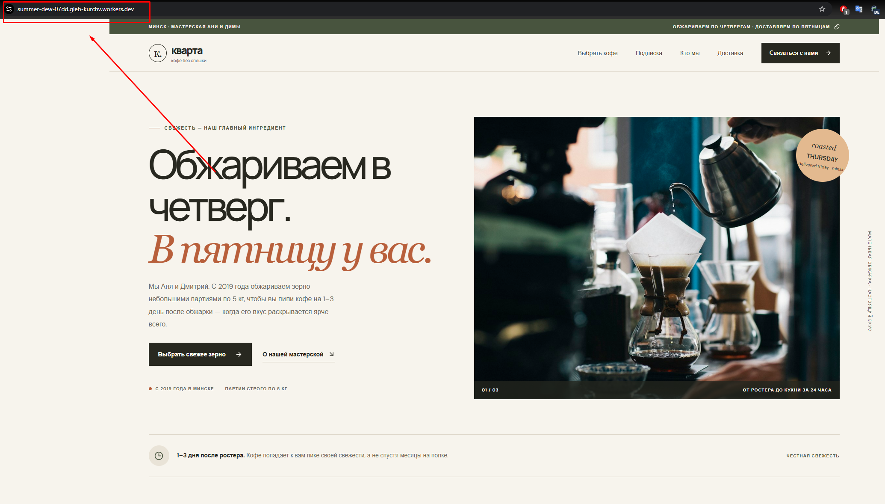
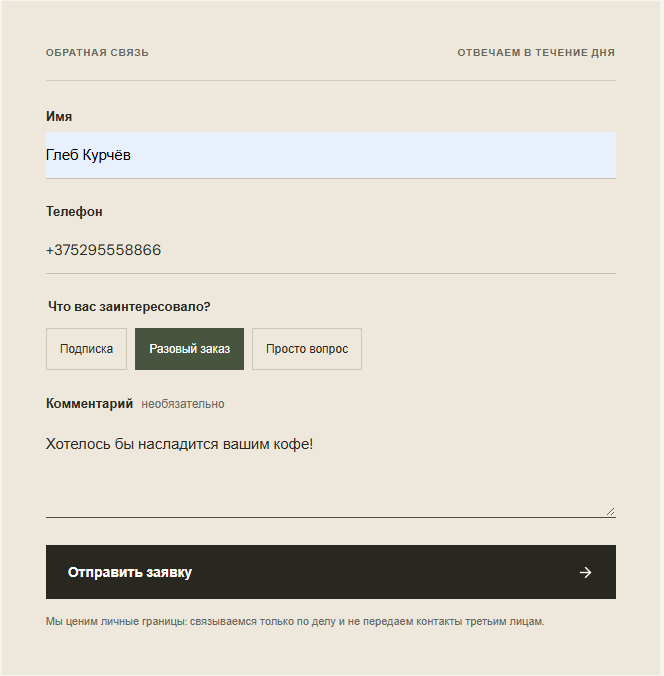
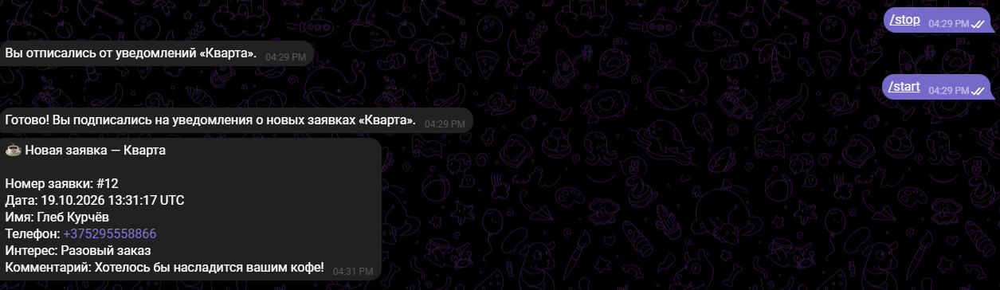

# Кварта — лендинг для обжарки кофе

Веб-сайт для небольшой кофейной мастерской из Минска. Проект предназначен для презентации мастерской и ассортимента кофе, ознакомления с условиями покупки и подписки, а также сбора заявок от потенциальных клиентов.

**Сайт:** [summer-dew-07dd.gleb-kurchv.workers.dev](https://summer-dew-07dd.gleb-kurchv.workers.dev/)

**Backend API:** [kvarta-api-production.up.railway.app](https://kvarta-api-production.up.railway.app)

## Скриншоты

### Главная страница

Главная страница опубликованного сайта с информацией о мастерской, ассортименте и предложениях.

### Форма отправки заявки

Форма обратной связи для потенциальных клиентов. Пользователь может указать имя и телефон, выбрать интересующую услугу — подписку, разовый заказ или задать вопрос — и оставить дополнительный комментарий.

### Telegram-уведомление о новой заявке

После отправки формы backend обрабатывает заявку и передаёт информацию Telegram-боту. Менеджер получает уведомление о новом обращении, что позволяет оперативно связаться с потенциальным клиентом.

## Выполненная работа

### Frontend

- Разработал адаптивный пользовательский интерфейс на React и TypeScript.
- Реализовал отображение информации о мастерской, ассортименте кофе, ценах, подписке, условиях доставки и контактных данных.
- Разработал форму обратной связи для сбора заявок от потенциальных клиентов.
- Настроил взаимодействие frontend с backend через HTTP API.
- Проверил отображение сайта на разных размерах экрана и исправил обнаруженные проблемы с вёрсткой, стилями и читаемостью элементов.
- Подготовил production-сборку приложения с помощью Vite.

### Backend и обработка заявок

- Разработал backend на Python с использованием FastAPI.
- Реализовал API для приёма заявок с сайта.
- Добавил проверку белорусских номеров телефонов.
- Реализовал защиту от повторной отправки заявки в течение 10 минут.
- Настроил хранение заявок в SQLite с использованием SQLAlchemy.
- Настроил CORS для разрешения запросов с опубликованного frontend.
- Добавил endpoint `/health` для проверки доступности backend.

### Интеграция с Telegram

- Реализовал Telegram-бота для уведомления менеджера о новых заявках.
- Настроил обработку входящих обновлений Telegram Bot API.
- Связал обработку заявок на backend с отправкой уведомлений менеджеру.
- Проверил получение уведомлений после отправки формы с опубликованного сайта.

### Отслеживание источников трафика

Реализовал сбор информации об источниках переходов и рекламном трафике. Эти данные позволяют анализировать, откуда приходят потенциальные клиенты и какие каналы приводят к отправке заявок.

### Тестирование и исправление ошибок

- Проверил основные пользовательские сценарии: открытие сайта, заполнение формы и отправку заявки.
- Анализировал логи frontend и backend для выявления причин ошибок.
- Проверил взаимодействие между опубликованным сайтом и удалённым API.
- Исправил конфигурацию адреса API для production-среды.
- Проверил работу Telegram-уведомлений после развёртывания.

## Архитектура и используемые сервисы

Проект разделён на frontend и backend, которые развёрнуты независимо друг от друга.

| Компонент | Технологии и сервисы | Назначение |
|---|---|---|
| Frontend | React, TypeScript, Vite | Пользовательский интерфейс сайта |
| Frontend hosting | Cloudflare Workers | Публикация production-сборки сайта |
| Backend | Python, FastAPI | API и обработка заявок |
| Backend hosting | Railway | Развёртывание и запуск backend |
| База данных | SQLite, SQLAlchemy | Хранение заявок и данных приложения |
| Постоянное хранилище | Railway Volume | Сохранение файла базы данных между перезапусками |
| Уведомления | Telegram Bot API | Передача информации о новых заявках менеджеру |
| Контейнеризация | Docker, Docker Compose | Настройка контейнеров и окружения приложения |
| Контроль версий | Git | Отслеживание изменений исходного кода |

### Взаимодействие компонентов

1. Пользователь открывает сайт, размещённый на Cloudflare Workers.
2. При отправке формы frontend передаёт данные в backend на FastAPI.
3. Backend проверяет полученные данные и обрабатывает заявку.
4. Данные сохраняются в SQLite.
5. Telegram-бот отправляет менеджеру уведомление о новом обращении.

## Развёртывание

### Frontend — Cloudflare Workers

Frontend собирается с помощью Vite. Готовые статические файлы размещаются на Cloudflare Workers. Адрес backend задаётся через переменную окружения `VITE_API_URL` на этапе сборки.

Опубликованный сайт доступен по адресу:

[https://summer-dew-07dd.gleb-kurchv.workers.dev/](https://summer-dew-07dd.gleb-kurchv.workers.dev/)

### Backend — Railway

Backend размещён на Railway и предоставляет API для работы с формой заявок. Конфигурация production-среды задаётся через переменные окружения.

Для хранения SQLite используется постоянный том Railway Volume, подключённый по пути `/data`. Это позволяет сохранять файл базы данных при перезапусках приложения.

Доступность backend проверяется через endpoint `/health`.

## Технологический стек

- **Язык программирования:** Python
- **Backend:** FastAPI
- **Frontend:** React, TypeScript
- **Сборка frontend:** Vite
- **База данных:** SQLite
- **ORM:** SQLAlchemy
- **Интеграции:** Telegram Bot API
- **Контейнеризация:** Docker, Docker Compose
- **Хостинг:** Cloudflare Workers, Railway
- **Контроль версий:** Git

## Использование ИИ

ИИ использовался как вспомогательный инструмент при разработке, поиске причин ошибок и доработке кода. Предложенные изменения проверялись вручную: тестировались пользовательские сценарии, анализировались логи и проверялась работа интеграций в production-среде.
